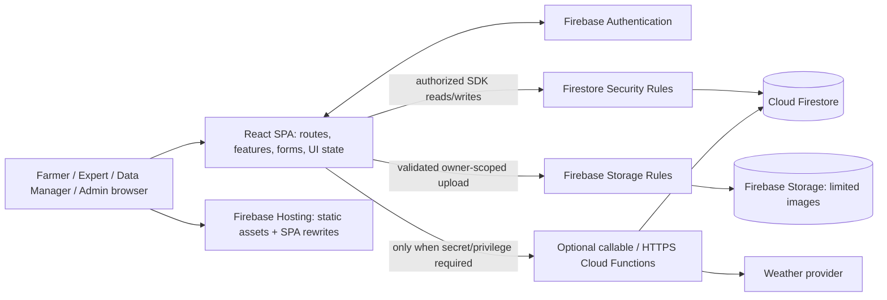
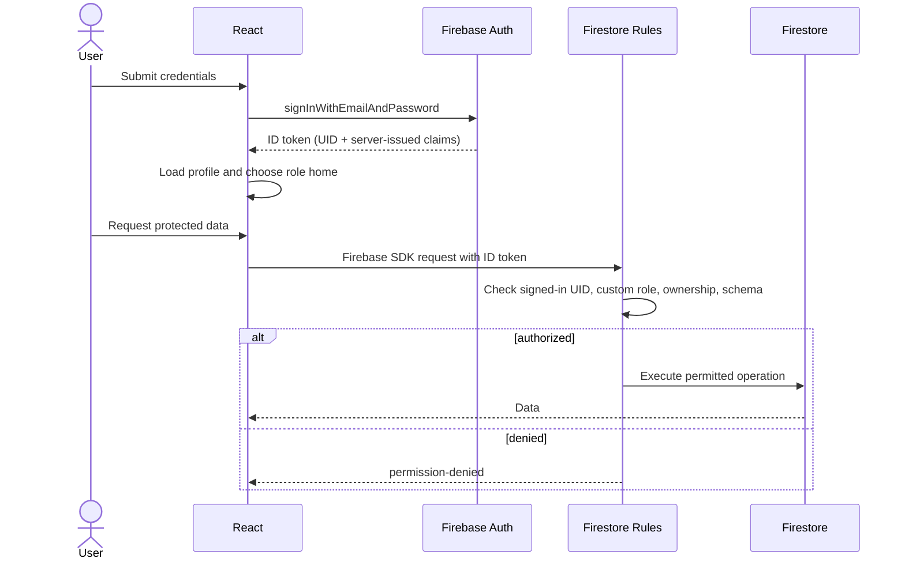
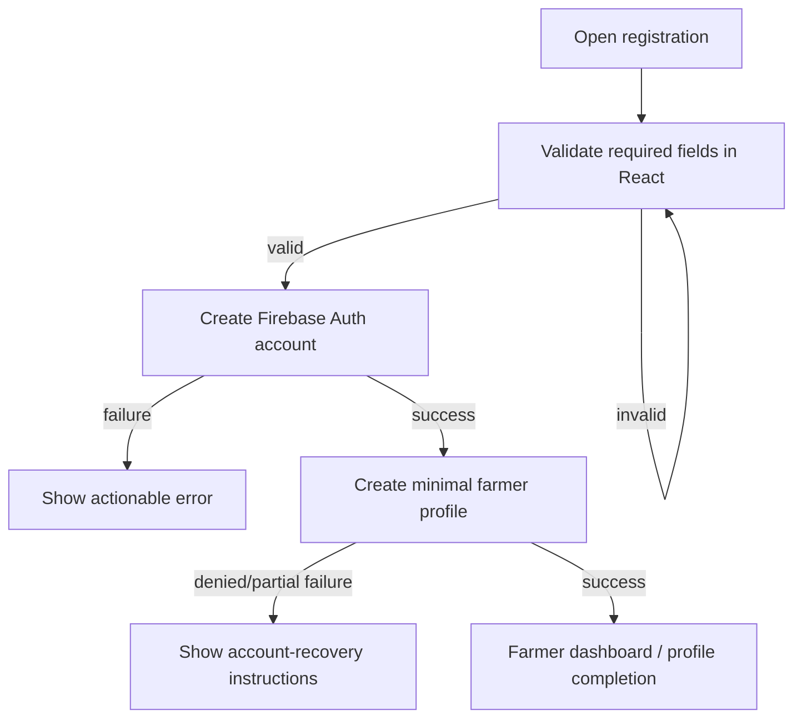
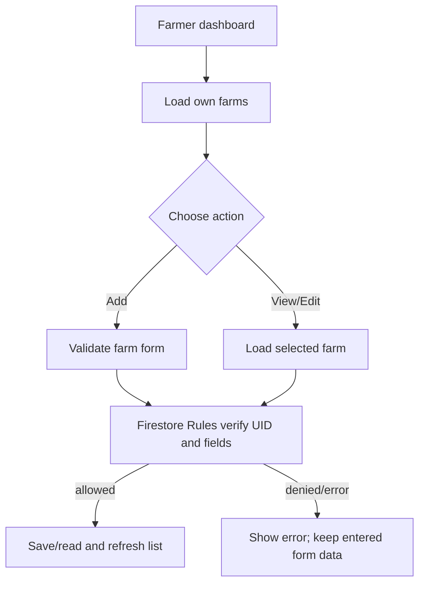
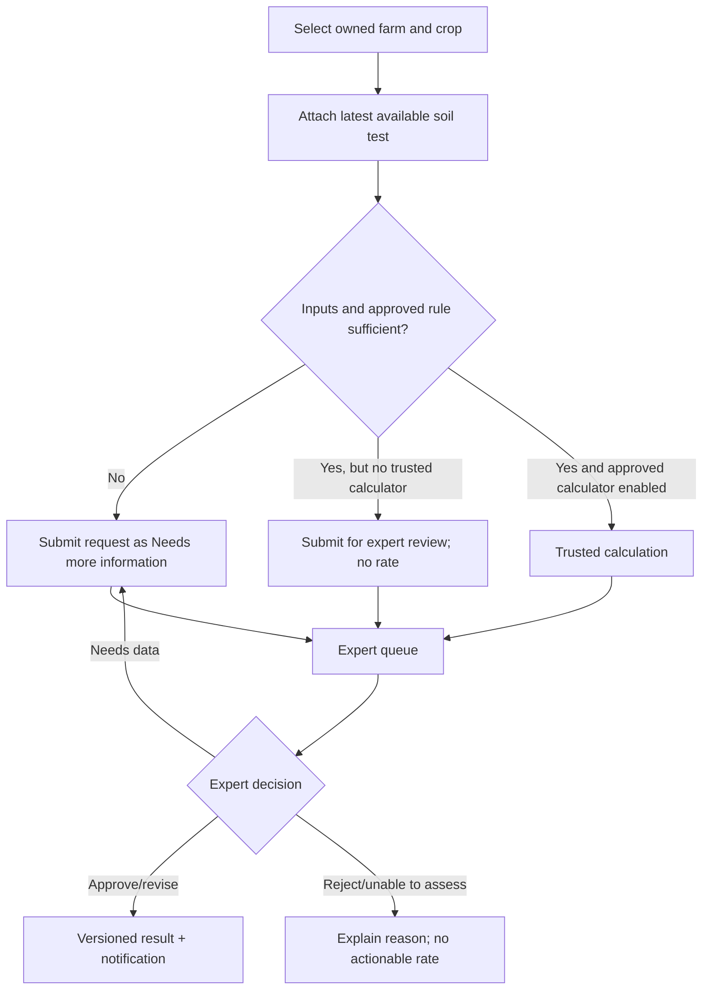
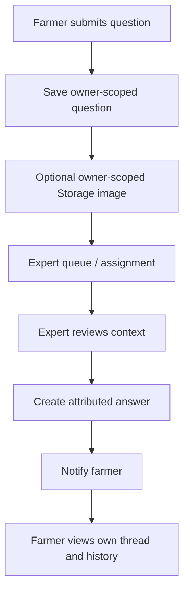
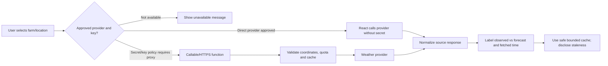
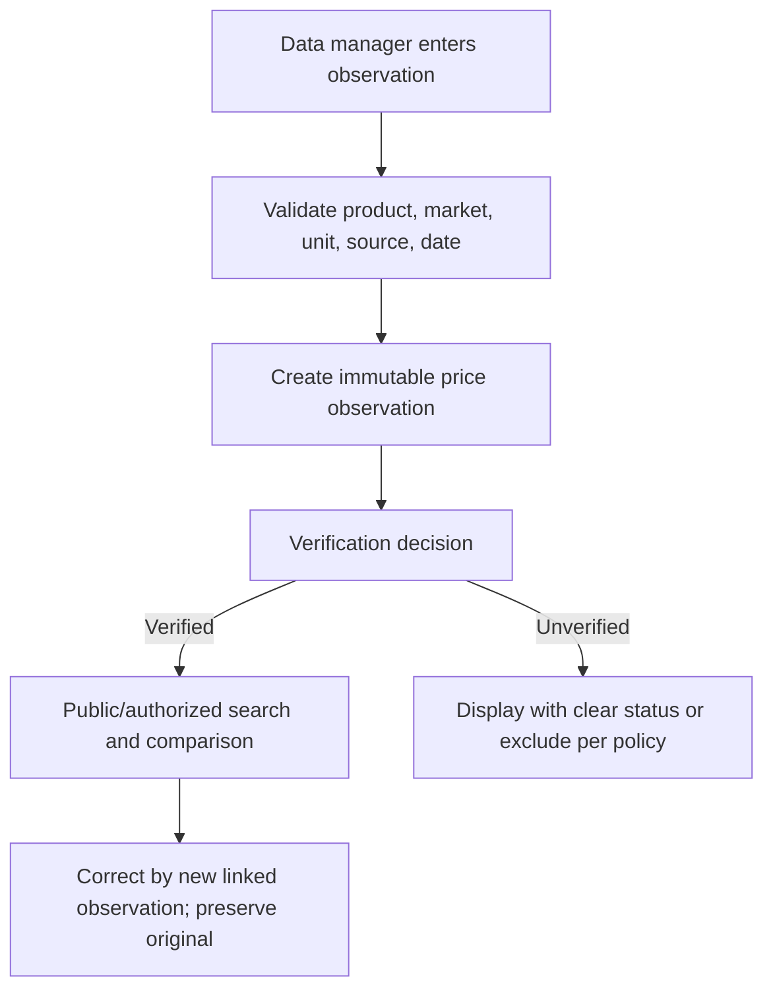
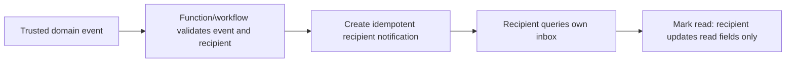
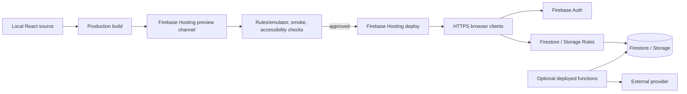

# 01. System Architecture

## Status and source baseline

This is a Phase 2 design proposal, not an implementation record. The original `Smart_Agriculture_Management_System_SRS.docx` and application source code were not present in the workspace at design time. The available sources are the seven Phase 1 documents, particularly the functional baseline FR-001–FR-131 and NFR-001–NFR-054. Any schema detail, policy, provider, alert behavior, or threshold not defined there is marked **To be confirmed with stakeholders**. Validate this design against the original SRS before implementation or production use.

## Architecture overview

Use a responsive React single-page application hosted by Firebase Hosting, Firebase Authentication for identity, Cloud Firestore for structured data, and Firebase Storage only for limited question images. React is a presentation and orchestration client, not a trust boundary. Firestore and Storage Security Rules enforce every client-accessible operation. Keep Cloud Functions out of routine CRUD paths; introduce only narrow privileged functions where the client cannot safely hold a secret or perform a privileged operation.

### Frontend architecture

- Organize React by user-facing feature: authentication, farms, crops, soil tests, recommendations, questions, weather, markets, notifications, and administration.
- Use React Router with public, authenticated, and role-protected layouts. Route checks improve UX only; security rules remain authoritative.
- Use the Firebase modular JS SDK behind typed service modules. Do not scatter raw SDK calls through view components.
- Keep server state in Firestore/TanStack Query (if adopted), transient form state in React Hook Form, and authentication/session state in a small Auth Context.
- Do not store secrets, authoritative roles, calculated trusted rates, or authorization decisions in frontend code.

### Firebase backend architecture

| Service | Responsibility | Not its responsibility |
| --- | --- | --- |
| Firebase Authentication | Sign-in, sign-out, password reset, stable UID | Application role authorization by itself |
| Firestore | Profiles, farms, reference data, workflow records, notifications, reports | Server-side validation of arbitrary domain algorithms |
| Firestore Rules | Enforce user/role/ownership access, immutable fields, bounded schema checks | UI hiding, complex joins, secret API calls |
| Firebase Storage | Limited crop/question images | Public hosting of private images |
| Storage Rules | Owner, type, size, path and related-question checks | Malware scanning or image decoding |
| Cloud Functions (optional) | Narrow privileged tasks: role claim provisioning, secret weather proxy/cache, trusted recommendation calculation, event-generated notifications | Routine reads/writes that client rules can safely govern |
| Firebase Hosting | Static React bundle, HTTPS, SPA rewrite | Dynamic API execution |

The current free-tier application uses `users/{uid}.role` as its authorization source, protected by Firestore Rules: farmers can self-create only farmer profiles, and an active superadmin can manage other users. The first superadmin is bootstrapped by the Firebase project owner in Console. A future migration to server-issued custom claims would require a separately approved trusted backend; clients must never assign themselves elevated roles.

## Component communication and module data flows

| Module | Flow | Enforcement and notes |
| --- | --- | --- |
| Registration/profile | React validates fields → Firebase Auth creates identity → profile initialization → farmer creates/updates own profile | Auth establishes UID. Initial client profile can have only the fixed farmer role/status; privileged roles are provisioned out-of-band. A partial failure must show recovery guidance, not report success. |
| Farm management | Farmer form → Firestore `farms` create/update → owner-scoped query/list/detail | Rules require `ownerUid == request.auth.uid`; server timestamps; no client-changed owner. |
| Crop catalog | Public query reads active/public crops; admin edits through restricted rule path | Public fields only; admin content change policy and soft-delete are stakeholder decisions. |
| Soil test | Farmer selects owned farm → records dated measurements/source → expert reviews only an explicitly assigned record if approved | Missing numeric values remain absent/null, never coerced to zero. Preserve source/verification metadata. |
| Fertilizer recommendation | Farmer submits linked farm/crop/soil IDs → rule/engine verifies inputs → expert reviews → farmer reads result/history | No unsupported rate. Use a privileged calculation only after expert-approved rules are specified; otherwise create a pending request and show no rate. |
| Expert Q&A | Farmer creates private question → optional image upload → expert queue/assignment → answer history → farmer reads own thread | Rules scope farmer access to own records and expert access to assigned/open work per agreed policy. A safe assignment workflow is required. |
| Market prices | Data manager creates dated observation → verification/correction review → public query returns permitted records | Append a correction as a new observation or retain an audit snapshot; never silently rewrite history. Public verification visibility is a stakeholder decision. |
| Notifications | Privileged workflow event → recipient-specific notification document → recipient reads and marks read | Do not let clients invent notifications or write a different recipient. Event creation should be idempotent. |
| Reports/export | Role-scoped query with filters and page cursors → client summary/chart → CSV generated locally | Export only records authorized for that role. Keep page/row caps; no bulk unrestricted scans. |

## Authentication and authorization

Frontend route guards redirect unauthenticated users to login and authenticated users away from irrelevant role areas. Firestore/Storage Rules decide access for all direct SDK requests. Treat missing, inactive, or unsupported Firestore profile roles as deny. Profile role changes take effect through Firestore profile listeners.

## Mermaid user-flow diagrams

### Farmer registration

### Farm management

### Fertilizer recommendation

### Expert question and answer

### Weather data

### Market-price data

### Notification

### Deployment

## External weather API and image uploads

### Weather

The UI selects an explicit farm/location and sends coordinates only where permitted. Normalize provider data into observed, forecast, alert, source, and fetched-time fields. Show source and timestamp; do not imply observed data is a forecast or vice versa. A provider and API-key policy are not specified in the Phase 1 documents, so provider choice, quota, cache TTL and alert semantics remain **To be confirmed with stakeholders**. If the chosen provider requires a secret or enforceable shared quota, call it through a minimal function and cache; do not embed a secret in React. If it permits public browser calls and has no secret, direct calls avoid function cost but expose the key/quota to abuse.

### Image upload

Validate on client for usability, then rely on Storage Rules for enforcement: authenticated user, question ownership, allowed image MIME type, size cap from requirements (2 MB in the supplied Phase 2 brief), safe UID/question-scoped path, and question visibility. Store only path/metadata in Firestore; avoid public download URLs for private content. Storage Rules do not inspect image contents; malware/image validation requirements need further threat-model confirmation.

## Deployment and free-tier usage control

- Commit `firestore.rules`, `storage.rules`, indexes, and Firebase Hosting configuration; deploy rules before client releases.
- Use Firebase Emulator Suite for rules and integration tests. Separate development/production projects; no production data in tests.
- Keep queries bounded (`limit`), cursor-paginated, indexed, and scoped by owner/status/date. Avoid broad listeners and polling; unsubscribe on unmount.
- Cache only data whose freshness policy is agreed; avoid duplicating whole collections into dashboards.
- Compress images before upload; enforce rules-side size/type caps.
- Make weather requests on demand, cache by coarse approved location/time key, set timeouts, and prevent duplicate requests.
- Prefer client-side CSV for already-authorized, paged report data; avoid function-generated exports unless scale or access policy requires server-side generation.
- Track usage, quota errors, storage size, function invocations, and query read counts; set operational alerts where available. Free-tier included limits and current product eligibility must be verified before launch.
- Avoid scheduled or high-frequency functions. Functions can incur billing even when the intent is “free”; current Firebase plan eligibility must be checked.
