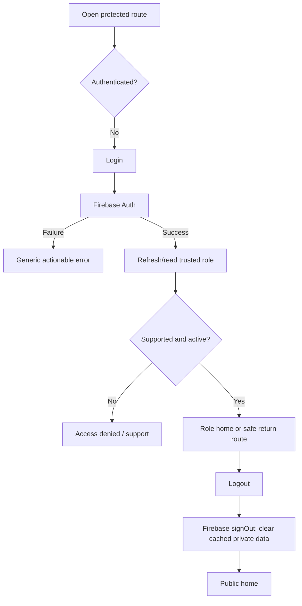
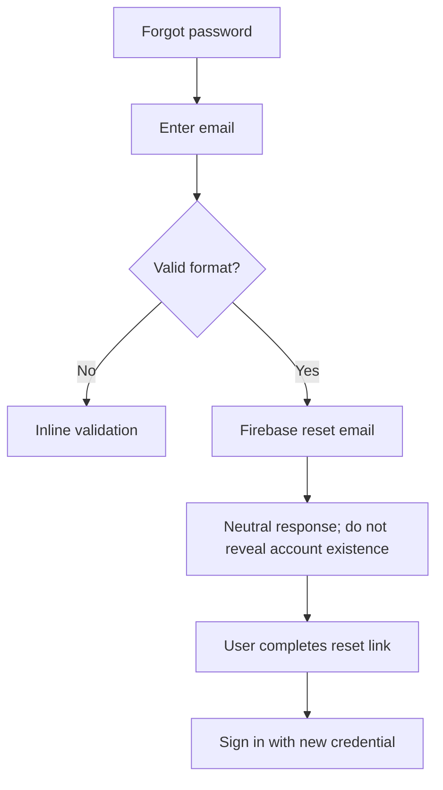
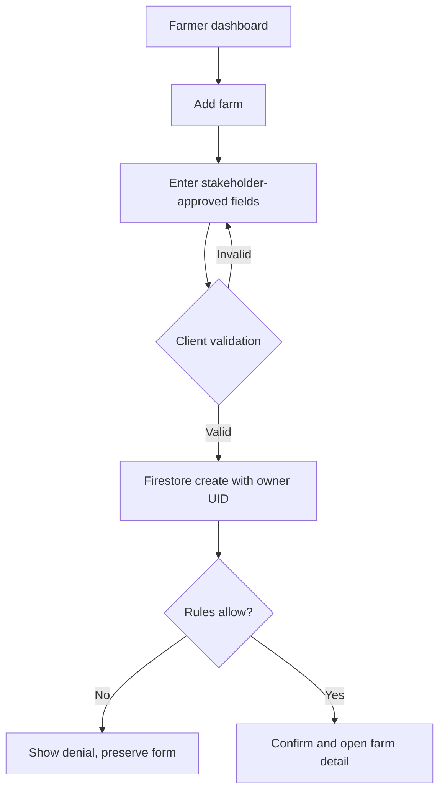
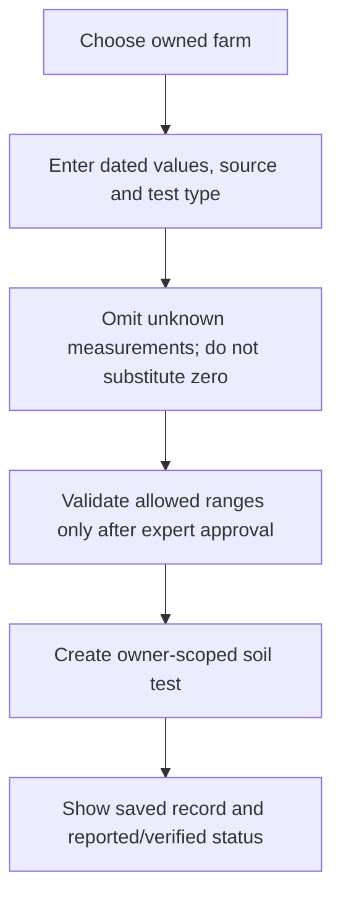
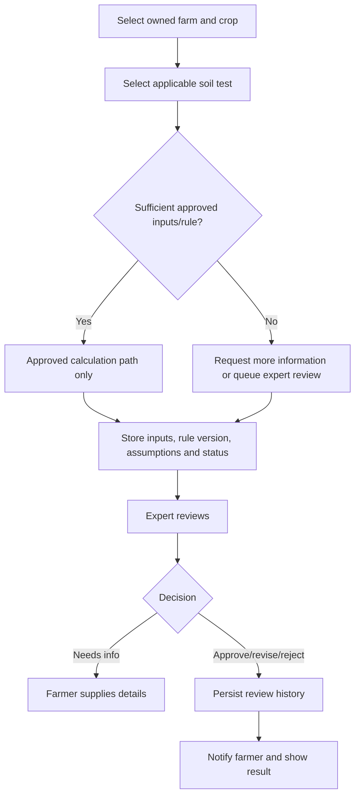
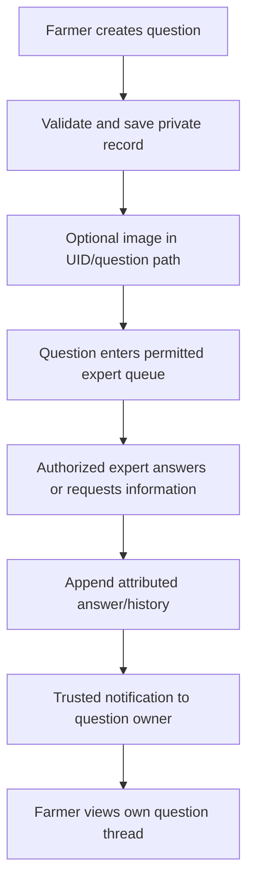
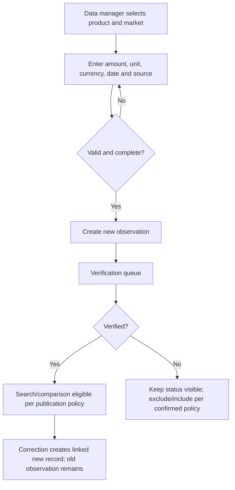
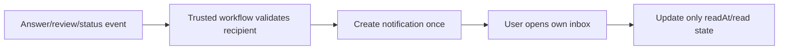
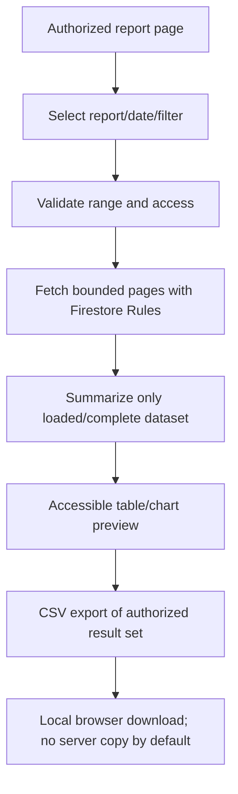

# 04. Navigation and User Flows

## Status

Route names below are proposed. Validate route access and account lifecycle against the original SRS, which was not present in the workspace.

## Menus

| Audience | Primary navigation |
| --- | --- |
| Public | Home, Crops, Weather, Market prices, Login, Register |
| Farmer | Dashboard, Profile, Farms, Crops, Soil tests, Recommendations, Ask expert, Questions, Weather, Market prices, Notifications |
| Expert | Dashboard, Question inbox, Recommendation review, Soil-record review, Profile, Notifications |
| Data manager | Dashboard, Markets, Products, Market prices, Verification queue, Reports if explicitly authorized, Profile |
| Administrator | Dashboard, Users, Roles, Crops, Soil-test assignments, Fertilizers, Markets, Public content, Questions, Activity log, Reports, Profile |

Do not expose every protected menu item to every role. Menu visibility and redirects are convenience features only.

## Route protection and redirects

| Route kind | Rule | Redirect/denial |
| --- | --- | --- |
| Public | No sign-in required; public Firestore reads must still be permitted by rules | None |
| Authenticated | Firebase Auth session required | Unauthenticated user → `/login?returnTo=…` |
| Role protected | Requires a valid token claim for designated role | Wrong role → that role’s home or `/access-denied`; Rules deny direct data access |
| Pending auth/profile/claim | Show neutral loading state; do not assume farmer/admin | Retry/re-authenticate or access-denied; never grant by default |
| Disabled user | Account status enforcement must be settled; client route gate is not sufficient to block Auth token use | Disable Auth account through privileged process and deny via claim/status policy |

### Login/logout

### Password reset

### Farm registration

### Soil-test submission

### Fertilizer recommendation

No application rate may be generated from unsupported assumptions. Missing nutrient measurements are not zero.

### Question and answer

### Market-price entry and correction

### Notification

### Report generation

## Route map (proposal)

`/` public; `/crops`, `/crops/:cropId`, `/weather`, `/markets/prices`; `/login`, `/register`, `/forgot-password`; `/farmer/*`; `/expert/*`; `/data/*`; `/admin/*`; `/access-denied`; `/not-found`. Use nested layouts and route-level lazy loading. Never trust a route parameter as proof of ownership; each document fetch is checked by Rules.

## Open navigation decisions

Confirm whether public users may view weather and market prices, whether experts may inspect unassigned questions, how experts receive assignments, whether report access extends to data managers, and how account deactivation revokes existing sessions. These choices directly affect menus, filters, claims and Security Rules.
